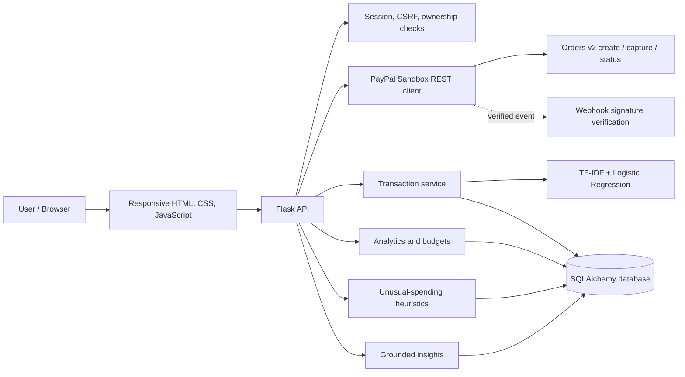

# InHouseTX — PayPal AI Spending Intelligence

<p align="center">
  <strong>Understand Every Transaction. Make Every Payment Count.</strong>
  <br />
  Explainable transaction intelligence for clearer spending decisions.
</p>

<p align="center">
  <a href="LICENSE"></a>
  
  
  
  
  
</p>

InHouseTX turns payment activity into understandable financial context. It combines a PayPal **Sandbox** checkout workflow with transaction categorisation, model explanations, currency-aware analytics, unusual-spending signals, and grounded financial insights.

> **Prototype and payment boundary:** This repository is configured for PayPal Sandbox only. It does not process live payments or connect to real PayPal consumer histories. A payment is recorded as PayPal activity only after the backend checks the order/capture with PayPal. CSV imports and seeded examples are labelled separately. The live Sandbox buyer-approval/capture round trip has not yet been verified in the current project evidence.

---

## At a glance

| Capability | What it provides |
|---|---|
| PayPal Sandbox checkout | Server-created Orders v2, buyer approval, server-side capture and status reconciliation |
| Explainable categorisation | TF-IDF + Logistic Regression category prediction, probability and feature contributions |
| Human review | Low-confidence queue, category corrections and explicit candidate-model retraining |
| Spending intelligence | Filterable summaries, category and merchant views, budgets and currency-separated totals |
| Unusual-spending signals | Historical amount/frequency heuristics with explainable factors; not a fraud verdict |
| Grounded insights | Deterministic answers computed from persisted user transactions; optional LLM wording |
| Demo data provenance | Synthetic seed data and CSV imports remain clearly distinct from PayPal-verified payments |

## Product experience

The responsive application is served by Flask. There is no separate frontend package installation or build step.

The editable product design is available in [Figma](https://www.figma.com/design/f4BTFU5wEmutlA2FetAxoI). The implementation uses the documented evergreen/stone visual system described in [docs/DESIGN_SYSTEM.md](docs/DESIGN_SYSTEM.md).

### Screenshots

Actual browser captures from the local synthetic-data QA session are stored in [reports/screenshots](reports/screenshots/).

| Dashboard | Transactions | Analytics |
|---|---|---|
|  |  |  |

Additional captures: [empty dashboard](reports/screenshots/desktop_dashboard_empty.png), [anomaly centre](reports/screenshots/desktop_anomaly_centre.png), and [settings](reports/screenshots/desktop_settings.png).

Screenshots contain synthetic QA records, not personal or live payment data. Browser QA is partial: tablet/mobile checks and pixel-level Figma comparison remain outstanding. See [reports/UI_UX_REDESIGN_REPORT.md](reports/UI_UX_REDESIGN_REPORT.md).

---

## How it works

1. **Create a Sandbox order.** The authenticated browser requests an order from the Flask backend. The server uses its PayPal REST credentials and a server-generated idempotency key.
2. **Approve with PayPal.** The buyer reviews the order in the PayPal JavaScript SDK approval experience.
3. **Capture on the server.** The browser sends the approved order ID to InHouseTX. The backend calls PayPal Orders v2, checks capture state, amount and currency, and only then persists a PayPal-sourced transaction.
4. **Categorise and explain.** The local classifier predicts a category and exposes confidence and model-feature contribution details. Lower-confidence results can be reviewed.
5. **Understand activity.** Deterministic analytics group totals by currency. Historical heuristics can surface unusual amounts or frequencies. The insights endpoint answers questions from persisted transaction facts.

A webhook endpoint can verify PayPal signatures using PayPal's verification API and reconcile eligible events. Webhook verification requires a configured webhook ID and a publicly reachable HTTPS endpoint.

## Architecture

InHouseTX is a Flask modular monolith with a same-origin browser UI.



See [docs/ARCHITECTURE.md](docs/ARCHITECTURE.md) for module responsibilities, storage details and date/currency rules.

## Technology

- **Backend:** Python 3.10+, Flask
- **Persistence:** SQLAlchemy, SQLite for local development, PostgreSQL URL support
- **Machine learning:** scikit-learn, TF-IDF, Logistic Regression
- **Payments:** PayPal REST API Orders v2, OAuth 2.0, PayPal JavaScript SDK, webhook signature verification
- **Frontend:** HTML, CSS, vanilla JavaScript, same-origin fetch/session flow
- **Quality:** pytest, Python compile checks, Node JavaScript syntax checks
- **Optional language-model phrasing:** OpenAI-compatible provider configuration; deterministic insights remain available without an API key

See [docs/TECHNOLOGY_STACK.md](docs/TECHNOLOGY_STACK.md) for the verified stack and [requirements.txt](requirements.txt) for Python dependencies.

---

## Run locally

### Prerequisites

- Python 3.10 or newer
- A terminal
- PayPal Developer Sandbox credentials only if you want to exercise checkout

### 1. Clone and install

```sh
git clone https://github.com/ESpoorthy/inhouseTX-Tech4Good.git
cd inhouseTX-Tech4Good

python3 -m venv .venv
source .venv/bin/activate
pip install -r requirements.txt
```

### 2. Configure environment

```sh
cp .env.example .env
```

Set a unique local `SECRET_KEY`. For PayPal checkout, add Sandbox app credentials:

```dotenv
ENVIRONMENT=development
PAYPAL_MODE=sandbox
PAYPAL_CLIENT_ID=your_sandbox_client_id
PAYPAL_CLIENT_SECRET=your_sandbox_secret
PAYPAL_WEBHOOK_ID=
FRONTEND_ORIGIN=http://127.0.0.1:3001
AI_PROVIDER=deterministic
```

Use the exact origin and port shown by your local Flask server. The webhook ID is needed for webhook signature verification, not for order creation/capture. Never put a PayPal Secret in browser code or commit `.env`.

### 3. Initialise and start

```sh
python scripts/migrate.py
python -m api.app
```

Open the URL printed by Flask (the documented default is `http://127.0.0.1:3001`; check your local `PORT` configuration if it differs).

### 4. Seed clearly labelled demo records (optional)

```sh
python scripts/seed_demo.py
```

The seeder creates synthetic records and a local demo account. It prints a one-time password; use it only in your local demo and do not publish it. Seeded rows are not PayPal transactions.

### 5. Run tests and checks

```sh
python -m pytest -q
python -m compileall -q api model scripts migrations tests
node --check frontend/vanilla.js
git diff --check
```

The latest local QA report recorded **26 passing tests**. Re-run the commands on the current checkout before relying on that result. The automated PayPal tests use mocked provider responses; they do not prove a live Sandbox checkout.

---

## PayPal Sandbox setup

1. Create a PayPal Developer account.
2. In **Apps & Credentials**, select **Sandbox** and create a REST app as a **Merchant**.
3. Copy that app's Sandbox Client ID and Secret into the backend `.env`.
4. Create or use a separate Sandbox Personal buyer account in **Testing Tools → Sandbox Accounts**.
5. Restart Flask, open **Settings → PayPal Sandbox**, and confirm that the integration reports configured.
6. Start checkout, approve it using the Sandbox buyer, and let the backend capture the approved order.
7. Confirm the captured status and saved transaction in InHouseTX.

For webhook testing, register a public HTTPS endpoint ending in `/api/paypal/webhooks`, subscribe to the documented capture events, and put the resulting webhook ID into `PAYPAL_WEBHOOK_ID`.

Detailed instructions and verification boundaries: [docs/PAYPAL_INTEGRATION.md](docs/PAYPAL_INTEGRATION.md).

## AI and model methodology

The hackathon categorisation pipeline uses a scikit-learn TF-IDF word unigram/bigram representation and Logistic Regression. The included training corpus contains **240 synthetic merchant-description examples** across six categories. A grouped holdout experiment compared Multinomial Naive Bayes and Logistic Regression.

The recorded synthetic holdout result for Logistic Regression was accuracy **0.7797** and macro F1 **0.7407** on 59 held-out rows. These values describe only this small generated dataset and must not be interpreted as real-world merchant recognition, calibrated confidence, or financial decision quality.

Explanations are based on the selected linear model's TF-IDF feature contributions. They are not SHAP/LIME explanations in the new prediction path. Feedback is stored for human review; retraining creates a candidate artifact and does not silently replace the active model.

Read [docs/AI_ML_PIPELINE.md](docs/AI_ML_PIPELINE.md) for methodology and limitations.

## Security and data handling

- PayPal Client Secret remains server-side.
- Checkout success is based on server-side provider capture/status, not a browser redirect.
- Session authentication, CSRF checks, owner-scoped transaction access and request limits are implemented.
- Decimal-safe analytics do not combine unlike currencies.
- Webhook events require provider signature verification and are de-duplicated.
- Synthetic and CSV-imported rows retain provenance labels.
- This prototype is not production financial software. Before public deployment, use HTTPS, managed secrets, persistent database infrastructure, and an appropriate multi-worker rate-limit/session strategy.

See [docs/SECURITY.md](docs/SECURITY.md) and [docs/KNOWN_LIMITATIONS.md](docs/KNOWN_LIMITATIONS.md).

## Original project and hackathon contribution

InHouseTX originated as **“Automated AI-Based Financial Transaction Categorisation”**, developed by **Team Tech4Good** for the **GHCI 2025 Hackathon**. This work preserves the original attribution, MIT license, project materials, taxonomy, data and model utilities.

The PayPal AI Hackathon 2026 branch adds the Sandbox payment workflow, persistent user transactions, the expanded categorisation/feedback flow, analytics, budgets, anomaly heuristics, grounded insights, browser UI, tests and submission materials. The contribution log distinguishes this new work from the original project; it does not imply that every original contributor participated in the later work.

See [docs/HACKATHON_CHANGELOG.md](docs/HACKATHON_CHANGELOG.md).

## Project documentation

| Document | Description |
|---|---|
| [Project overview](docs/PROJECT_OVERVIEW.md) | Product narrative, audience and value proposition |
| [About InHouseTX](docs/ABOUT_SECTION.md) | Reusable public-facing About copy |
| [Architecture](docs/ARCHITECTURE.md) | Runtime architecture and data flow |
| [Technology stack](docs/TECHNOLOGY_STACK.md) | Verified technologies and responsibilities |
| [API reference](docs/API_DOCUMENTATION.md) | Routes, authentication and CSV schema |
| [PayPal integration](docs/PAYPAL_INTEGRATION.md) | Orders, capture, webhooks and Sandbox setup |
| [AI/ML pipeline](docs/AI_ML_PIPELINE.md) | Training, explanation, evaluation and limitations |
| [Analytics and anomalies](docs/ANALYTICS_AND_ANOMALIES.md) | Financial calculations and signals |
| [Design system](docs/DESIGN_SYSTEM.md) | Figma source and interface rules |
| [Testing](docs/TESTING.md) | Automated and manual verification |
| [Security](docs/SECURITY.md) | Security controls and operational notes |
| [Deployment](docs/DEPLOYMENT.md) | Local and hosted deployment guidance |
| [Hackathon changelog](docs/HACKATHON_CHANGELOG.md) | Original foundation versus 2026 additions |
| [Known limitations](docs/KNOWN_LIMITATIONS.md) | Honest verification boundaries |
| [Devpost draft](submission/DEVPOST_SUBMISSION.md) | Submission narrative and links to complete |

## Acknowledgements and license

MIT License — see [LICENSE](LICENSE).

Original project acknowledgement: **Team Tech4Good, GHCI 2025 Hackathon**. The later PayPal AI Hackathon work is separately documented in the repository.

---

<p align="center">
  <strong>InHouseTX</strong><br />
  Financial clarity, built with explainable AI.
</p>
