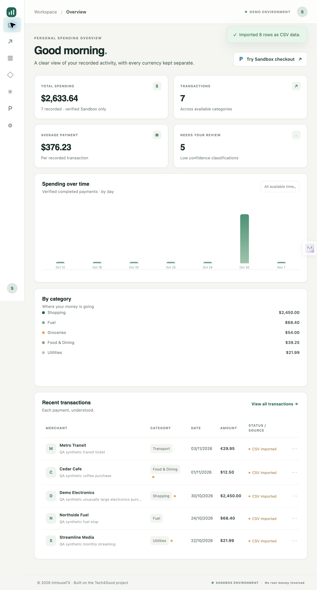
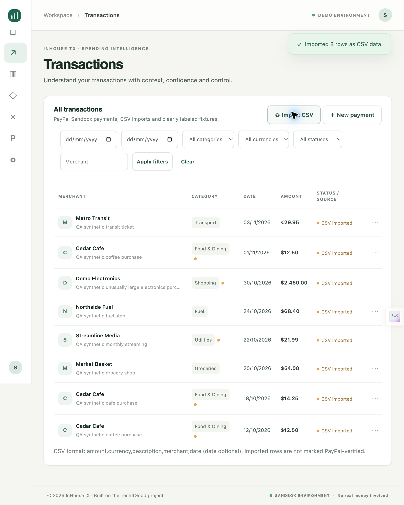
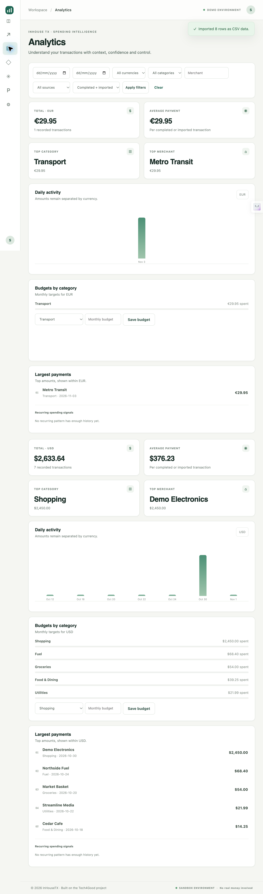
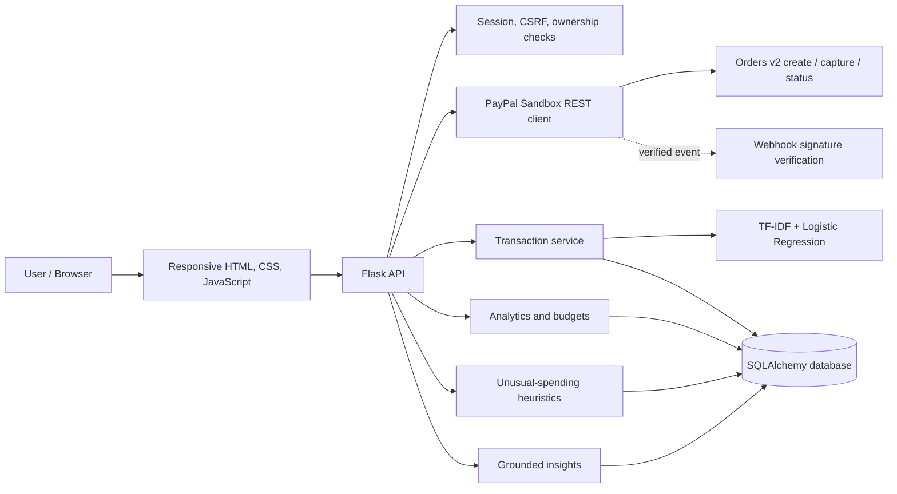

# InHouseTX — PayPal AI Spending Intelligence

<p align="center">
  <strong>Understand Every Transaction. Make Every Payment Count.</strong>
  <br />Explainable transaction intelligence for clearer spending decisions.
</p>

<p align="center">
  <a href="LICENSE"></a>
  
  
  
  
  
</p>

InHouseTX turns payment activity into understandable financial context. It combines a PayPal **Sandbox** checkout workflow with transaction categorisation, model explanations, currency-aware analytics, unusual-spending signals, and grounded financial insights.

> **Live deployment:** [Open InHouseTX](https://inhouse-tx-mkmu.onrender.com). The app is hosted on Render in Sandbox-only mode. PayPal checkout requires `PAYPAL_CLIENT_ID` and `PAYPAL_CLIENT_SECRET` to be configured in the Render service environment; checkout is not yet verified on the deployed app.

> **Prototype boundary:** Sandbox only; no live payments or unrestricted PayPal account-history access. A payment is recorded as PayPal activity only after server-side provider verification. CSV imports and seeded examples are labelled separately. Complete buyer approval/capture with Sandbox credentials before claiming it as live-tested.

## At a glance

| Capability | What it provides |
|---|---|
| PayPal Sandbox checkout | Server-created Orders v2, buyer approval, server-side capture and status reconciliation |
| Explainable categorisation | TF-IDF + Logistic Regression prediction, probability and feature contributions |
| Human review | Low-confidence queue, category corrections and explicit candidate-model retraining |
| Spending intelligence | Filterable summaries, category/merchant views, budgets and currency-separated totals |
| Unusual-spending signals | Historical amount/frequency heuristics; not a fraud verdict |
| Grounded insights | Deterministic answers from persisted transactions; optional LLM phrasing |
| Data provenance | Synthetic seed data and CSV imports remain distinct from PayPal-verified payments |

## Product experience

The responsive application is served by Flask; no separate frontend package installation or build is required. Explore the editable [Figma design](https://www.figma.com/design/f4BTFU5wEmutlA2FetAxoI) and [design system](docs/DESIGN_SYSTEM.md).

### Screenshots

Actual Chrome captures from local synthetic-data QA:

| Dashboard | Transactions | Analytics |
|---|---|---|
|  |  |  |

More captures: [empty dashboard](reports/screenshots/desktop_dashboard_empty.png), [anomaly centre](reports/screenshots/desktop_anomaly_centre.png), [settings](reports/screenshots/desktop_settings.png). These show synthetic QA records, not personal or live payment data. Browser QA is partial: tablet/mobile checks and pixel-level Figma comparison remain outstanding. See [UI/UX verification](reports/UI_UX_REDESIGN_REPORT.md).

## How it works

1. **Create a Sandbox order.** The authenticated browser requests an order from Flask. The server uses its PayPal REST credentials and an idempotency key.
2. **Approve with PayPal.** The buyer reviews the order through the PayPal JavaScript SDK.
3. **Capture on the server.** The browser sends the approved order ID to InHouseTX. The backend calls PayPal Orders v2, checks capture state, amount and currency, and only then persists a PayPal-sourced transaction.
4. **Categorise and explain.** The local classifier predicts a category and exposes confidence and model-feature contribution details. Lower-confidence results can be reviewed.
5. **Understand activity.** Deterministic analytics group totals by currency. Historical heuristics can surface unusual amounts or frequencies. Insights answer questions from persisted transaction facts.

The webhook endpoint can verify signatures through PayPal's verification API. It requires a configured webhook ID and a publicly reachable HTTPS endpoint.

## Architecture

InHouseTX is a Flask modular monolith with a same-origin browser UI.



See [architecture](docs/ARCHITECTURE.md) for module responsibilities and storage details.

## Technology

- **Backend:** Python 3.10+, Flask
- **Persistence:** SQLAlchemy, SQLite locally, PostgreSQL URL support
- **Machine learning:** scikit-learn, TF-IDF, Logistic Regression
- **Payments:** PayPal REST Orders v2, OAuth 2.0, PayPal JavaScript SDK, webhook verification
- **Frontend:** HTML, CSS, vanilla JavaScript
- **Quality:** pytest, Python compile checks, Node syntax checks
- **Optional language-model phrasing:** OpenAI-compatible provider configuration; deterministic insights work without an API key

See [verified technology stack](docs/TECHNOLOGY_STACK.md) and [requirements.txt](requirements.txt).

## Repository layout

```text
.
├── api/                         Flask routes, services and data models
├── frontend/                    Same-origin browser interface and styles
├── model/                       Current and preserved legacy ML workflows
├── data/                        Synthetic training data and archived legacy inputs
├── scripts/                     Migration, demo seeding and model operations
├── migrations/                  Database schema setup
├── tests/                       Automated tests and synthetic fixtures
├── utils/                       Shared helpers and taxonomy loader
├── main.py                      Local model smoke-test entry point
├── docs/
│   ├── assets/original-diagrams/ Original project diagrams
│   ├── original-project/         GHCI 2025 PDFs and archive notes
│   └── specifications/           Phase 0 requirements/design/task records
├── tools/
│   ├── figma/                    Figma construction utilities
│   └── qa/                       Local API and browser QA utilities
├── reports/                      Verification reports and screenshots
└── submission/                   Devpost and demo-video materials
```

The root is intentionally limited to project metadata, configuration templates and the small CLI entry point. The original seven-row merchant dataset, taxonomy and legacy feedback placeholder are retained under `data/`; only `synthetic_training.csv` feeds the current model. Original assets are preserved under [docs/original-project](docs/original-project/README.md); optional development utilities are under [tools](tools/README.md). See [repository organisation](docs/FILE_ORGANISATION.md).

## Run locally

### Prerequisites
- Python 3.10 or newer
- PayPal Developer Sandbox credentials only if testing checkout

### 1. Clone and install

```sh
git clone https://github.com/ESpoorthy/inhouseTX-Tech4Good.git
cd inhouseTX-Tech4Good
python3 -m venv .venv
source .venv/bin/activate
pip install -r requirements.txt
```

### 2. Configure environment

```sh
cp .env.example .env
```

Set a unique local `SECRET_KEY`. For checkout, use Sandbox app credentials:

```dotenv
ENVIRONMENT=development
PAYPAL_MODE=sandbox
PAYPAL_CLIENT_ID=your_sandbox_client_id
PAYPAL_CLIENT_SECRET=your_sandbox_secret
PAYPAL_WEBHOOK_ID=
FRONTEND_ORIGIN=http://127.0.0.1:3001
AI_PROVIDER=deterministic
```

Use the exact origin and port printed by Flask. The webhook ID is needed for webhook signature verification, not order creation/capture. Never expose a PayPal Secret in browser code or commit `.env`.

### 3. Initialise and start

```sh
python scripts/migrate.py
python -m api.app
```

Open the URL printed by Flask (the documented default is `http://127.0.0.1:3001`; check your local `PORT` setting if it differs).

### 4. Seed labelled demo records (optional)

```sh
python scripts/seed_demo.py
```

The seeder creates synthetic records and a local demo account. It prints a one-time password; treat it as local demo access and never publish it. Seeded rows are not PayPal transactions.

### 5. Run tests and checks

```sh
python -m pytest -q
python -m compileall -q api model scripts migrations tests
node --check frontend/vanilla.js
git diff --check
```

The latest local QA report recorded **26 passing tests**. Re-run these commands on the exact checkout before release. Automated PayPal tests use mocked responses and do not prove live Sandbox checkout.

## PayPal Sandbox setup

1. Create a PayPal Developer account.
2. In **Apps & Credentials**, select **Sandbox** and create a REST app as a **Merchant**.
3. Add its Sandbox Client ID and Secret to the backend `.env`.
4. Create/use a separate Sandbox Personal buyer account in **Testing Tools → Sandbox Accounts**.
5. Restart Flask and check **Settings → PayPal Sandbox**.
6. Start checkout, approve with the Sandbox buyer, and let the backend capture the approved order.
7. Confirm captured status and the saved transaction in InHouseTX.

For webhook testing, register a public HTTPS endpoint ending in `/api/paypal/webhooks`, subscribe to the required capture events, and set the resulting ID in `PAYPAL_WEBHOOK_ID`. See [PayPal integration](docs/PAYPAL_INTEGRATION.md).

## AI and model methodology

The hackathon categorisation pipeline uses scikit-learn TF-IDF word unigrams/bigrams and Logistic Regression. The included corpus contains **240 synthetic merchant-description examples** across six categories. A grouped holdout experiment compared Multinomial Naive Bayes and Logistic Regression.

The recorded synthetic holdout result for Logistic Regression was accuracy **0.7797** and macro F1 **0.7407** on 59 held-out rows. These describe only this small generated dataset, not real-world merchant recognition, calibrated confidence or financial decision quality.

Explanations use the selected linear model's TF-IDF feature contributions; they are not SHAP/LIME explanations in the new prediction path. Feedback is stored for review; retraining creates a candidate artifact and does not silently replace the active model. Read [AI/ML methodology](docs/AI_ML_PIPELINE.md).

## Security and data handling

- PayPal Client Secret remains server-side.
- Checkout success is based on server-side provider capture/status, not a browser redirect.
- Session authentication, CSRF checks, owner-scoped transaction access and request limits are implemented.
- Analytics do not combine unlike currencies.
- Webhook events require provider signature verification and are de-duplicated.
- Synthetic and CSV-imported rows retain provenance labels.
- This is not production financial software. Before public deployment, use HTTPS, managed secrets, persistent database infrastructure and an appropriate multi-worker session/rate-limit strategy.

See [security](docs/SECURITY.md) and [known limitations](docs/KNOWN_LIMITATIONS.md).

## Original project and hackathon contribution

InHouseTX originated as **“Automated AI-Based Financial Transaction Categorisation”**, developed by **Team Tech4Good** for the **GHCI 2025 Hackathon**. The original attribution, MIT license, project materials, taxonomy, data and model utilities are retained.

The PayPal AI Hackathon 2026 branch adds the Sandbox payment workflow, persistent user transactions, expanded categorisation/feedback, analytics, budgets, anomaly heuristics, grounded insights, browser UI, tests and submission materials. The contribution log separates this work from the original and does not imply every original contributor participated in the later development.

See [hackathon changelog](docs/HACKATHON_CHANGELOG.md) and [original project archive](docs/original-project/README.md).

## Project documentation

| Document | Description |
|---|---|
| [Project overview](docs/PROJECT_OVERVIEW.md) | Product narrative and value proposition |
| [About InHouseTX](docs/ABOUT_SECTION.md) | Public-facing About copy |
| [Architecture](docs/ARCHITECTURE.md) | Runtime architecture and data flow |
| [Technology stack](docs/TECHNOLOGY_STACK.md) | Verified tools and responsibilities |
| [API reference](docs/API_DOCUMENTATION.md) | Routes, authentication and CSV schema |
| [PayPal integration](docs/PAYPAL_INTEGRATION.md) | Orders, capture, webhooks and Sandbox setup |
| [AI/ML pipeline](docs/AI_ML_PIPELINE.md) | Training, explanations and limitations |
| [Analytics and anomalies](docs/ANALYTICS_AND_ANOMALIES.md) | Financial calculations and signals |
| [Design system](docs/DESIGN_SYSTEM.md) | Figma source and interface rules |
| [Testing](docs/TESTING.md) | Automated and manual verification |
| [Security](docs/SECURITY.md) | Security controls and operational notes |
| [Deployment](docs/DEPLOYMENT.md) | Local and hosted deployment guidance |
| [Hackathon changelog](docs/HACKATHON_CHANGELOG.md) | Original foundation versus 2026 additions |
| [Known limitations](docs/KNOWN_LIMITATIONS.md) | Honest verification boundaries |
| [Devpost draft](submission/DEVPOST_SUBMISSION.md) | Submission narrative and fields to complete |

## Acknowledgements and license

MIT License — see [LICENSE](LICENSE). Original project acknowledgement: **Team Tech4Good, GHCI 2025 Hackathon**. Later PayPal AI Hackathon work is separately documented.

---

<p align="center"><strong>InHouseTX</strong><br />Financial clarity, built with explainable AI.</p>
